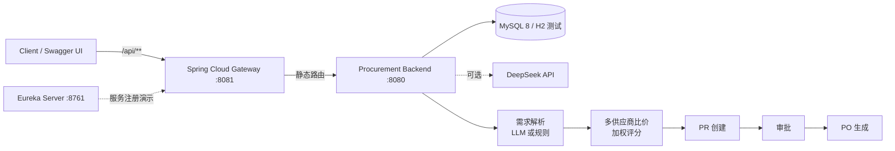

# Smart Procurement Backend（Java / Spring Boot）

采购需求 → 结构化 → 多供应商比价 → PR → 审批 → PO 的后端 MVP。

> 个人作品集项目：用于展示 Java/Spring Boot 后端能力与采购业务建模，不是生产系统。生产化差距见文末。

## 架构



## 技术栈

- Java 21
- Spring Boot 3.5
- MyBatis（注解 Mapper）
- MySQL 8（生产）/ H2（测试，MySQL 兼容模式）
- Flyway（数据库版本管理）
- Springdoc OpenAPI（Swagger UI）
- JUnit 5 + MockMvc
- Spring Cloud：Eureka + Gateway（`cloud/` 演示模块）

## 功能

- 自然语言需求解析：数量、品类、品牌、预算、交期
- 常见错字纠正（笔记本/显示器/平板等）
- 多供应商比价：价格、预算、交期、评分、库存加权打分
- 采购申请 PR：`PR-yyyyMMdd-####`
- 审批：`APPROVE` / `REJECT`，采购员越权返回 403
- 审批通过自动生成 PO：`PO-yyyyMMdd-####`
- 报价有效期：过期报价不参与比价
- 可选 LLM 抽取，失败自动回退规则
- Swagger / OpenAPI 文档

## 快速开始

### 方式一：本地 MySQL

```bash
mysql -u root -p -e "create database procurement character set utf8mb4"

export DB_URL='jdbc:mysql://localhost:3306/procurement?useSSL=false&allowPublicKeyRetrieval=true&serverTimezone=Asia/Shanghai&characterEncoding=utf8'
export DB_USER=root
export DB_PASSWORD=your_password

mvn spring-boot:run
```

访问：

- Swagger UI：`http://localhost:8080/swagger-ui.html`
- OpenAPI JSON：`http://localhost:8080/v3/api-docs`
- 健康检查：`http://localhost:8080/actuator/health`

### 方式二：Docker Compose

```bash
docker compose up -d --build
```

> 本机没有 Docker，Compose 未实际启动验证；Dockerfile 和编排文件已提供。

## API

| 方法 | 路径 | 说明 |
|---|---|---|
| POST | `/api/v1/procurement/analyze` | 自然语言需求 → 比价 + PR |
| GET | `/api/v1/procurement/requests` | PR 列表 |
| GET | `/api/v1/procurement/requests/{id}` | PR 详情 |
| POST | `/api/v1/procurement/requests/{id}/approve` | 审批（`X-Role: approver`） |
| GET | `/api/v1/catalog/products?kind=laptop` | 商品目录 |
| GET | `/api/v1/catalog/suppliers` | 供应商 |

示例：

```bash
curl -X POST http://localhost:8080/api/v1/procurement/analyze \
  -H 'Content-Type: application/json' \
  -d '{"text":"采购 2 台联想笔记本，预算 10000"}'
```

```bash
curl -X POST http://localhost:8080/api/v1/procurement/requests/1/approve \
  -H 'Content-Type: application/json' \
  -H 'X-Role: approver' \
  -d '{"approver":"王经理","action":"APPROVE","note":"同意"}'
```

## LLM 需求抽取（可选）

默认 `LLM_MODE=rules`，不依赖任何外部服务。

```bash
export LLM_MODE=deepseek
export DEEPSEEK_API_KEY=sk-...
# 可选：LLM_BASE_URL、LLM_MODEL、LLM_TIMEOUT_SECONDS
mvn spring-boot:run
```

流程：

1. 模型输出 JSON `items[]`；
2. 校验品类、数量、预算；
3. 超时、非 JSON、字段非法或模型不可用时，自动回退规则解析。

这样单测和本地开发不依赖 API Key；演示时再开 LLM。

## Spring Cloud 模块

`cloud/` 下提供一个可运行的 Spring Cloud 演示：

- Eureka 服务注册中心（8761）
- Spring Cloud Gateway（8081），把 `/api/**` 转发到采购后端（8080）

启动方式和验证命令见 [cloud/README.md](cloud/README.md)。

## 项目结构

```text
src/main/java/com/example/procurement
├── ProcurementApplication.java
├── ProcurementController.java      # 采购分析、PR、审批
├── CatalogController.java          # 商品/供应商
├── ProcurementService.java         # 比价、PR、PO
├── DemandParser.java               # 规则解析
├── HybridDemandExtractor.java      # LLM + 规则兜底
├── LlmProperties.java
├── CatalogMapper.java              # MyBatis
└── RequestMapper.java              # MyBatis

src/main/resources/db/migration     # Flyway
cloud/                              # Eureka + Gateway
```

## 测试

```bash
mvn test
```

共 8 个测试：

- 需求解析与错字纠正
- LLM 关闭 / 无 Key 时回退规则
- 分析 → PR → 审批 → PO 全流程
- 采购员越权审批 403
- OpenAPI 文档

## 局限与生产化差距

### 当前局限

- **认证**：角色通过 `X-Role` 请求头模拟，没有 Spring Security、SSO、真实用户体系。
- **数据**：商品/报价为演示数据；没有供应商导入、报价导入、主数据治理。
- **ERP**：没有真实 ERP 对接，只有 PR/PO 本地落库。
- **审批**：只有单级审批接口，没有金额阈值、多级审批、审批链路配置。
- **LLM**：可选且非默认；没有 token 计量、成本统计、模型输出审计；未用真实 Key 联调。
- **Spring Cloud**：Gateway 使用静态 URI，Eureka 没有和采购后端真正注册/发现；没有配置中心、熔断、限流。
- **运维**：没有鉴权、限流、幂等、审计日志、指标监控、CI/CD、staging。
- **并发**：PR/PO 编号依赖日期 + 数据库 id，没有高并发下的发号器与幂等保障。

### 生产化清单

- Spring Security + OIDC/SSO，按租户和角色鉴权
- 供应商/报价导入 + 价格有效期 + 审批流配置
- 真实 ERP 适配器（幂等、对账、失败重试）
- 队列、限流、审计、指标、告警
- MySQL 备份/恢复、CI/CD、压测
- LLM 评测集、成本控制、输出校验与人工兜底
